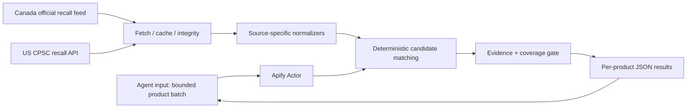
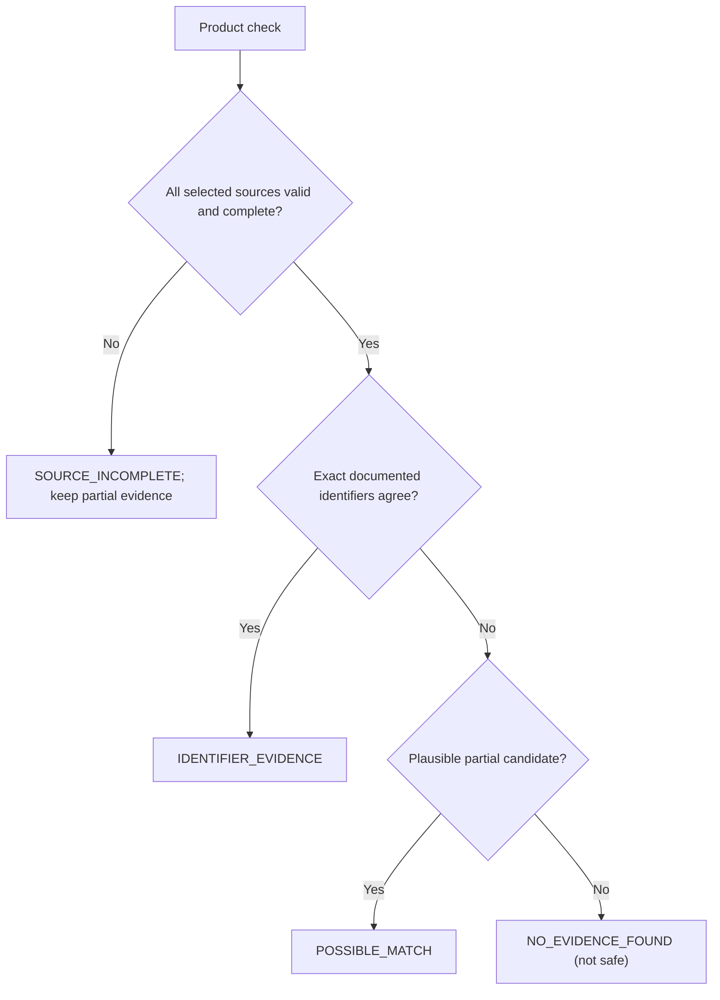

# Architecture (proposed, not implemented)

## Scope

Only **Canadian consumer-product recalls** and **US CPSC consumer-product recalls** in the first implementation. The Canada-wide recalls portal also covers foods, health products and motor vehicles; category filtering must be verified against real source data before implementation.

The source connectors must retain authority identity, official ID, official URL, published/updated timestamps when available, affected product description, model/lot qualifications and explicit parser warnings.

## Matching stages

1. Validate and bound input (suggested maximum 100 SKUs; each with internal SKU, brand, model, optional GTIN/lot/serial).
2. Fetch/cache the two official sources with integrity and freshness checks. Do not equate HTTP success to complete data.
3. Normalize identifiers without silently stripping significant hyphens, prefixes, leading zeros or lot qualifiers.
4. Identify **supported candidates** with reproducible matched fields; missing required qualifiers prevent assertions of affected-unit identity.
5. Evaluate complete vs partial source coverage. Missing/failed authority => `SOURCE_INCOMPLETE`, even if some candidates were found.
6. Emit one result per input SKU with evidence and explicit limits.

## Trust boundaries and operational costs

- No catalogues or customer secrets persist across runs.
- Third-party external APIs can fail or change schemas; build independent source adapters with fixture tests.
- Bounded retries and source-version metadata; no fabricated `dataAsOf` when unavailable.
- Check CPSC usage policies, source licensing and limits; API accessibility alone is not blanket redistribution permission.
- Preserve only short essential official fields and link back to official notices.
- Do not assume low Apify costs without actual feed-size, caching and request tests.
